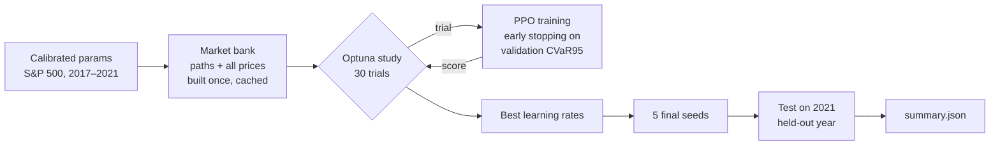

<div align="center">

# 🛡️ DeepHedging

### When should a hedger *not* trade?

**Deep reinforcement learning for option hedging under transaction costs:
a single actor-critic against an actor + learned "inaction" network.**


</div>

---

## ✨ The idea

With proportional transaction costs, re-hedging every day is expensive. The best hedge
trades only when the position has drifted far enough from where it should be.

This project asks whether a deep hedger learns that better when **"how much to hold"**
and **"whether to trade at all"** are separate decisions:

| | Single net | Double net |
|---|---|---|
| **Networks** | one actor-critic | actor-critic **+** inaction net |
| **Decision at each step** | new hedge position | proposed position, then *trade* or *hold* |
| **Hold mechanism** | must output the old position exactly | Bernoulli "hold" keeps the previous hedge |
| **Parameter budget** | hidden 64 | two nets of hidden 45 (≈ same size) |

Both are trained with PPO on simulated markets calibrated to S&P 500 options.
They are tuned with the same Optuna budget and evaluated on a held-out year.

---

## 🧪 Experiment grid

**Costs:** 1% per trade on the underlying and 5% of premium per trade on options.

| Dynamics | Liability to hedge | Hedging instruments | Nets |
|---|---|---|---|
| Black–Scholes | European call | underlying | single · double |
| Black–Scholes | Down-and-out call | call + put | single · double |
| Black–Scholes | Cash-or-nothing call | call + put | single · double |
| Heston | European call | underlying | single · double |
| Heston | Down-and-out call | call + put | single · double |
| Heston | Cash-or-nothing call | call + put | single · double |

**12 runs**, all with a 2-layer LSTM over the last 8 observations. Each run is one Slurm job.

---

## ⚙️ How a run works



* **Train / validation:** different simulated paths of the 2017–2020 calibrations.
* **Test:** the 2021 calibration. It is never used for tuning or early stopping.
* **Objective:** per-step tracking error `-|portfolio − liability|`, scaled by the premium.
* **Reported:** CVaR95 / VaR / mean / std of terminal P&L, costs paid, and hold rate. Results
  are given against no-hedge and Black–Scholes delta-hedge baselines.

### What the agent sees
| Input | Single net | Double net |
|---|:-:|:-:|
| Price and option-price changes, moneyness, time to maturity (last 8 steps) | ✅ | ✅ |
| Current holdings (the last executed hedge) | ✅ | ✅ |
| Tracking error so far, costs paid so far, steps since last trade | ✅ | ✅ |
| Proposed trade and what it would cost (inaction net only) | — | ✅ |

Every input is known at decision time. Nothing comes from the future of the path or from
the test year (see the [leakage audit](deep_hedging_v0/fast_hedging/NOTES.md#information-leakage-audit)).

---

## 🚀 Quickstart (HPC)

```bash
# 1. environment
module load python/3.11.7-gcc-12.2.0
python -m venv .venv && source .venv/bin/activate
pip install -r deep_hedging_v0/requirements.txt

# 2. smoke test: parity with the original environments + tiny end-to-end runs
cd deep_hedging_v0/experiments/simulations/slurm/liquid_1_5
mkdir -p logs && sbatch smoke_test.slurm

# 3. the full grid: builds market banks, then 12 runs (one job each)
bash submit_all.sh
```

Run a single experiment by hand:

```bash
cd deep_hedging_v0
python -m fast_hedging.experiment \
    --dynamics heston --product doc --arch rnn --rnn-mode window --window 8 --net double \
    --underlying-fee 0.01 --option-fee 0.05 \
    --n-trials 30 --out experiments/results/heston_doc_rnn_double
```

Jobs can be resumed: resubmitting the same Slurm file continues the Optuna study and skips
finished seeds.

---

## ⚡ Why it is fast

The first version stepped a Gym environment through TorchRL. It re-priced every option each
epoch and ran 22 fixed-length trainings back to back in each job. The current engine:

* **Prices once.** Paths and all option prices are cached per (model, product, split).
  Heston pricing is batched on the GPU, not looped point by point.
* **Hedges in tensors.** All paths step together on the GPU, with no Gym loop or
  NumPy round-trips.
* **Learns more per sample.** It runs 4 PPO epochs of minibatch updates per rollout,
  not one pass of 4 updates.
* **Stops when learning flattens.** Training stops after 100 iterations without improvement
  on validation. Optuna also stops weak trials early.

Its prices, features, rewards and P&L are checked against the original environments by
`python -m fast_hedging.tests.test_parity`.

---

## 📁 Repository layout

```
deep_hedging_v0/
├── fast_hedging/            # ⚡ current engine (PyTorch)
│   ├── market.py            #   simulation + cached market banks
│   ├── pricing.py           #   vectorised BS / Heston pricing, barrier Monte Carlo
│   ├── features.py          #   observation features
│   ├── networks.py          #   LSTM actor-critic, inaction net
│   ├── ppo.py               #   vectorised environment, PPO, evaluation, early stopping
│   ├── experiment.py        #   Optuna study → final seeds → test report
│   ├── tests/test_parity.py #   equivalence with the original environments
│   └── NOTES.md             #   design notes, bug log, leakage audit
├── hedging/                 # original Gym environments and simulators
└── experiments/
    ├── option_parameter_estimation/   # BS and Heston calibration to S&P 500 options
    ├── simulations/slurm/liquid_1_5/  # 🎯 one Slurm file per run
    └── simulations/slurm/old_pipeline # archived TorchRL jobs
```

---

## 📊 Results

> 🚧 Runs in progress. This table will be filled from each run's `summary.json`.

| Dynamics | Product | Single net CVaR95 ↓ | Double net CVaR95 ↓ | Hold rate | BS delta CVaR95 |
|---|---|:-:|:-:|:-:|:-:|
| BSM | call | – | – | – | – |
| BSM | DOC | – | – | – | – |
| BSM | CoN | – | – | – | – |
| Heston | call | – | – | – | – |
| Heston | DOC | – | – | – | – |
| Heston | CoN | – | – | – | – |

---

## 📚 Background

* Buehler, Gonon, Teichmann, Wood (2019). *Deep hedging*. Quantitative Finance.
* Whalley & Wilmott (1997). *An asymptotic analysis of an optimal hedging model for
  option pricing with transaction costs*. Mathematical Finance.
* Schulman et al. (2017). *Proximal Policy Optimization Algorithms*.
* Heston (1993). *A closed-form solution for options with stochastic volatility*.

<div align="center">
<sub>PhD research project · Queen Mary University of London</sub>
</div>
